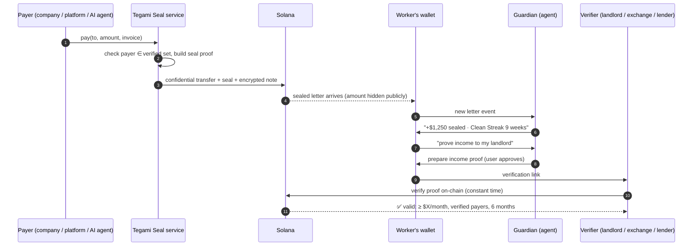
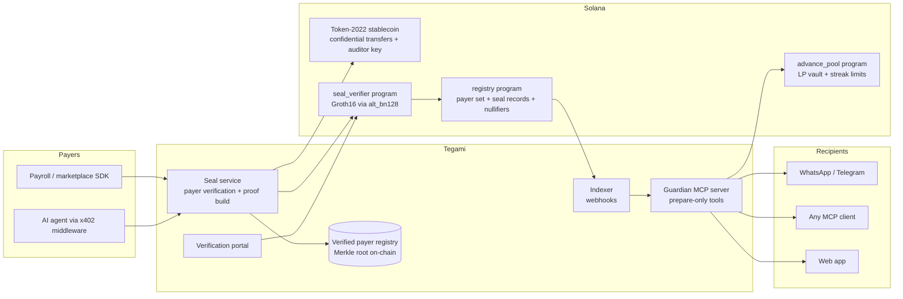

# Tegami ✉️

### Every payment, sealed.
**Private amount. Proven-clean source. A personal agent that defends it.**

Tegami (手紙, Japanese for "letter") turns every stablecoin payment into a **sealed letter**. The amount is hidden from the public, a zero-knowledge seal proves the money came from a verified source, and a personal AI agent called **Guardian** uses that proof to keep the recipient's money safe and working: income proofs, protection against frozen accounts, and credit earned from a clean payment history.

> Built on Solana for Colosseum's **Crypto World's Fair** (Sep 14 – Oct 12, 2026).
> **Status:** a native Android app (Kotlin, Compose) running on Solana **devnet** with a test token. What works today: a letters inbox read live from chain, registered-payer seals, confidential-transfer detection, wallet-signed income statements with minimal disclosure, an on-chain statement verifier, and a rule-based Guardian. The seal in this build is a payer-signed transaction plus a memo, **not** a zero-knowledge proof, and nothing here traces where funds came from. See [docs/ENGINEERING.md](docs/ENGINEERING.md) for exactly what is built, how to run it, and what is not. The sections below describe the full vision.

---

## Table of contents
1. [TL;DR](#tldr)
2. [The problem](#the-problem)
3. [Why now](#why-now)
4. [The insight](#the-insight)
5. [The product](#the-product)
6. [How it works](#how-it-works)
7. [Everything automated](#everything-automated)
8. [Designed to be effortless](#designed-to-be-effortless)
9. [Who uses Tegami](#who-uses-tegami)
10. [Architecture](#architecture)
11. [Privacy & security model](#privacy--security-model)
12. [Research foundation](#research-foundation)
13. [Competitive landscape](#competitive-landscape)
14. [Business model](#business-model)
15. [Go-to-market](#go-to-market)
16. [Roadmap](#roadmap)
17. [Risks & mitigations](#risks--mitigations)
18. [Demo](#demo)
19. [Hackathon fit](#hackathon-fit)
20. [Team](#team)
21. [Prior work disclosure](#prior-work-disclosure)
22. [Sources](#sources)

---

## TL;DR

Stablecoins made it possible to pay anyone, anywhere, in seconds. They did not make that money **trusted**.

- **Exposed:** on a public ledger, anyone can see your salary, your balance and who pays you.
- **Guilty by association:** compliance today means platforms scanning wallets for "bad" history. Honest people get frozen because someone else's dirty money touched them, sometimes through a deposit they never asked for.
- **Unprovable:** people paid in stablecoins can't easily prove their income or the cleanliness of their money to a landlord, bank, lender or exchange.
- **Getting worse:** AI agents are starting to pay humans. Money from an anonymous agent wallet is exactly what compliance systems distrust.

**Tegami fixes this at the moment money moves:**

| Part | What it does |
|---|---|
| **The Seal** | Every payment carries a zero-knowledge proof that it comes from a verified payer, with the amount hidden by Solana confidential transfers. |
| **Guardian** | A personal AI agent in WhatsApp, Telegram or any MCP client that screens incoming money, shares income proofs on request and assembles a defense pack if an account is frozen. |
| **Clean Streak** | Consecutive weeks of fully sealed income build a portable, private credit signal that unlocks advances and lower fees. |
| **Seal API** | Platforms that pay people (payroll, marketplaces, AI-agent platforms) issue sealed payments with one SDK call. |

---

## The problem

### 1. Open ledgers expose everyone
A public blockchain is a permanent, searchable record. Paying a contractor on-chain reveals their pay, their balance and their other clients to anyone who knows the address. That is why companies hesitate to run payroll on-chain, and why workers hesitate to accept it.

### 2. Compliance punishes the innocent
Today's anti-money-laundering model is **platform-side surveillance**: exchanges and banks trace wallet history with blocklists and "taint" analysis, then freeze anything that looks connected to bad money. The recipient has no way to show their money is clean *before* it is judged.

Recent examples:
- **Kraken, August 2026.** Nearly 12,000 tiny "dust" deposits from a wallet linked to a sanctioned exchange triggered automated screening, and Kraken temporarily locked customer accounts during review. The recipients did nothing; as the coverage put it, *"anyone can send tokens to a public address without consent."*
- **UK, January 2026.** A survey of ten major exchanges reported by the UK Cryptoasset Business Council found nearly **40% of customer transfers to exchanges are blocked or delayed by UK banks**, and 80% said it had worsened in the past year.
- **India, 2025–2026.** Honest sellers have had bank accounts frozen because a buyer paid with scam money. In one case a ₹175 credit froze an account holding ₹18.6 lakh for about eight months. Shopkeepers have been frozen for accepting payments from fraudsters; one trade association leader asked: *"How is a merchant expected to know the source of the money of a shopper?"*

The pattern is global: **when the receiver can't prove where money came from, the system assumes the worst.**

### 3. Stablecoin income is invisible to the real world
A worker paid by three foreign clients in stablecoins has real, regular income and no payslip a landlord, bank or visa office will accept. Their best financial record is locked in a wallet they can't safely show.

### 4. The next payer is an AI agent
Services like RentAHuman (launched February 2026) let AI agents hire people through an API call and pay them in stablecoins. When an anonymous agent wallet pays a human, nobody vouches for where that money came from.

---

## Why now

| Shift | Why it matters for Tegami |
|---|---|
| **Confidential transfers returned to Solana mainnet (June 17, 2026)** after a year-long security pause. | Hidden amounts with an optional auditor key are now available on a high-throughput chain. |
| **User-side provenance proofs became practical** (*Proof of Source of Funds*, June 2026). | A user can prove their funds trace to compliant sources, with constant-time verification and immunity to dust attacks. |
| **Stablecoin payroll went mainstream.** Deel added stablecoin salary payouts (May 2026), and payroll providers report payouts across 190+ countries. | Millions of people now receive income on-chain and inherit all three problems above. |
| **Agents started paying.** Solana carried about 70% of monthly x402 volume by mid-August 2026, and agent marketplaces began paying humans. | The "who vouches for the payer" problem is about to multiply. |
| **Regulators want privacy *with* accountability.** Compliant-privacy designs (Privacy Pools, selective disclosure) moved from papers to products. | Tegami fits that equilibrium: private by default, provable on demand, auditable by law. |

---

## The insight

> **Stop asking platforms to prove money is dirty. Let the people receiving it prove it's clean, privately, before anyone has to ask.**

Platform-side surveillance creates false positives, freezes and privacy loss. Recent research shows the opposite model works: the *user* holds a zero-knowledge proof that their funds trace back to a verified origin, and any verifier checks it in constant time without seeing the user's history.

Nobody has turned this into a product for the people who need it most: workers, freelancers and small businesses paid in stablecoins. Tegami does, and adds the parts that make it useful every day: privacy, a personal agent, and credit.

---

## The product

### ✉️ 1. The Seal
Every Tegami payment is a **sealed letter** containing:
- **The money:** a confidential stablecoin transfer. The amount is encrypted on-chain, and an optional auditor key enables lawful review.
- **The seal:** a zero-knowledge proof that the payer belongs to a verified payer set (a company treasury, a payroll provider, or the verified owner behind an AI agent), bound to this exact payment.
- **The note:** an encrypted memo with the invoice reference and a payslip, readable only by the recipient (and the auditor, if required).

Recipients accumulate a private **provenance record**: every inflow is already proven clean, so there is nothing to investigate later.

### 🛡️ 2. Guardian, your personal money agent
Guardian lives where people already are: WhatsApp, Telegram, or any MCP-compatible assistant (Claude, OpenClaw-style agents and others). It works in the user's language and understands voice notes.

| Moment | What Guardian does |
|---|---|
| **Before money arrives** | Checks the payer's seal. Unsealed money is quarantined in a separate address and never mixed with clean funds. *"Unknown payer, $340. Accept, return, or check?"* |
| **Every day** | *"+$68 today, sealed. Clean Streak: 23 days."* |
| **On request** | *"Send my landlord proof of income"* produces a verification link proving, for example, "earned ≥ $2,000/month for 6 months, all from verified payers," and nothing else. |
| **When cash is tight** | Offers an advance against verified future income, priced by Clean Streak. |
| **When a client pays late** | Sends polite reminders with a one-tap sealed payment link. |
| **When an account is frozen** | **Freeze Defense:** assembles the evidence pack (seal proofs, invoices, payslips, conversion receipts), drafts the response to the bank's or exchange's compliance team, tracks deadlines and suggests the escalation channels for the user's jurisdiction. |

Guardian never holds keys. It **prepares** actions; the user **approves** them with one tap or through limits they set once. Freeze Defense is document preparation, not legal advice, and it links users to qualified professionals.

### 🔥 3. Clean Streak, a streak that's worth money
Clean Streak counts consecutive weeks in which **every** inflow was sealed.

| Streak | Unlocks |
|---|---|
| 4 weeks | Shareable income and source-of-funds proofs |
| 8 weeks | Advance up to 25% of verified monthly income |
| 12+ weeks | Advance up to 50%, lower fees, priority off-ramp limits |

Accepting unsealed money from unknown payers resets the streak. That makes the habit loop reinforce exactly the behavior that keeps accounts safe. The streak is not decoration; it is an underwriting signal.

**Responsible by design:** advances are capped, there are no rollovers, fees are flat and shown upfront, and there are no lottery or gambling mechanics.

### 🔌 4. Seal API, for everyone who pays people
One SDK call issues a sealed payment:

```ts
import { Tegami } from "@tegami/pay";

await tegami.pay({
  to: "maya@studio.design",   // email, phone or wallet
  amount: "1250.00",
  currency: "USD",
  invoice: invoiceHash,
});
```

- **Payroll and contractor platforms:** sealed payouts, so their workers stop getting frozen.
- **Marketplaces and AI-agent platforms:** an x402 middleware so agents paying over HTTP automatically emit sealed payments traceable to their verified owner.
- **Off-ramps and exchanges:** accept seal proofs at deposit and skip expensive after-the-fact chain analysis.
- **Lenders, landlords and verifiers:** check income and source-of-funds proofs with one API call.

---

## How it works



**What each party sees**

| Party | Sees | Does not see |
|---|---|---|
| Public / block explorer | That a transfer happened, and the payer and recipient addresses (Solana confidential transfers hide only the amount) | Amount (confidential transfers only), payslip |
| Recipient | Everything in their letters | Other people's payments |
| Verifier | The specific statement proven ("≥ $X/month, verified payers") | Exact amounts, client names, full history |
| Auditor (if configured) | Amounts, with a lawful key | Nothing beyond the configured scope |

---

## Everything automated

The rule: **the agent prepares everything; money moves only with one tap from the user or under limits the user set once.**

1. **Auto-seal:** payers' SDK seals every payment. Recipients set up nothing.
2. **Auto-proof:** the provenance record updates in the background with each payment.
3. **Auto-quarantine:** unsealed inflows go to a separate holding address so they never contaminate clean funds.
4. **Auto-split:** a one-time rule ("70% to my bank, 30% kept in dollars") converts each payment through partner off-ramps and files the receipts.
5. **Auto-records:** every letter keeps its invoice, payslip and conversion receipt, exportable for accountants and tax filing.
6. **Auto-chase:** late invoices get reminders with sealed payment links.
7. **Auto-defend:** when a freeze or source-of-funds request arrives, the evidence pack is ready in minutes.

---

## Designed to be effortless

- **No new app required.** Guardian works inside the messengers people already use; a clean web app exists for those who want it.
- **No seed phrases.** Sign in with email or a passkey; network fees are sponsored.
- **Local currency first.** Amounts show in the user's currency. Words like "USDC", "proof" and "ZK" stay behind plain buttons.
- **Voice and any language.** Users can speak to Guardian in their own language.
- **One screen for businesses.** Agencies and exporters get a dashboard for incoming sealed payments and outgoing sealed team payouts.

---

## Who uses Tegami

| User | Type | Why they need it | When |
|---|---|---|---|
| **Freelancers and remote workers paid in stablecoins** | B2C | Privacy, clean-money proofs, income proofs, advances | **Beachhead (now)** |
| **Small agencies and exporters paid by foreign buyers** | B2B | Sealed receipts per invoice or shipment, sealed team payouts, freeze protection | **Now** |
| **Platforms that pay people** (payroll, marketplaces, AI-agent platforms) | B2B, paying customer | Fewer frozen workers, built-in compliance, a differentiated payout | **Now** |
| **Off-ramps, exchanges, lenders** | B2B, paying customer | Pre-verified clean deposits, cheaper compliance, underwriting data | **v1** |
| **Merchants and gig workers** | B2C / SMB | Same "where did this money come from?" problem | **Expansion, as on-chain payments reach retail** |

**Example user: Maya**, a freelance designer paid by clients in three countries. Today her payments are public, her exchange once asked for "source of funds" documents she couldn't easily produce, and her landlord doesn't accept wallet screenshots. With Tegami, every payment arrives sealed, Guardian answers source-of-funds requests in minutes, her landlord gets a one-line verified proof, and her 12-week Clean Streak gives her a cheaper advance when a client pays late.

---

## Architecture



### On-chain (Solana, Anchor)
| Program | Responsibility |
|---|---|
| `registry` | Merkle root of verified payer keys (updated by attestors), seal records, nullifiers that stop one clean payment being claimed twice |
| `seal_verifier` | Verifies Groth16 seal and income proofs using Solana's alt_bn128 syscalls |
| `advance_pool` | Liquidity-provider vault, streak-based limits, repayment from future sealed inflows |

### Token layer
A Token-2022 stablecoin with the **Confidential Transfer** extension and an auditor ElGamal key. The MVP uses a test mint with confidential transfers enabled. In production: a Token-2022 stablecoin that enables the extension, or a 1:1 wrapped confidential version of a major stablecoin.

### Circuits (Circom or Noir, Groth16)
| Circuit | Statement |
|---|---|
| **Seal v0** (MVP) | Payer ∈ verified set ∧ proof bound to this transfer ∧ amount commitment well-formed |
| **Income proof** | Sum of sealed inflows per month ≥ X for K consecutive months, from verified payers only |
| **Provenance v1** (roadmap) | Multi-hop: funds trace through any path back to a verified origin, using incrementally verifiable computation as in *Proof of Source of Funds* |

Each seal includes a commitment to the amount; the recipient holds the opening, so income proofs can be built later without revealing amounts.

### Off-chain
| Component | Responsibility |
|---|---|
| `@tegami/pay` SDK | One-call sealed payments for platforms |
| `@tegami/x402` | Middleware so x402 agent payments are sealed automatically |
| `tegami-mcp` | Guardian's tools: `check_seal`, `list_letters`, `prove_income`, `share_proof`, `prepare_advance`, `prepare_offramp`, `freeze_kit`, `set_rules` |
| Messenger bridge | WhatsApp and Telegram front-ends to `tegami-mcp` |
| Verification portal | Public page that checks a proof link on-chain |
| Off-ramp adapters | Standard interface for partners to accept seal proofs |

---

## Privacy & security model

**Principles**
- **Private by default, provable on demand, auditable by law.** Tegami is not a mixer. It never pools or obscures where funds came from; it proves it.
- **Prepare, never sign.** Guardian and all `prepare_*` tools return unsigned transactions. Signing happens in the user's own wallet (passkey or embedded wallet) under user-set spending limits.
- **Untrusted text stays data.** Payment memos, invoices and messages are treated as data, never as instructions to the agent. This blocks prompt-injection attacks hidden in payment notes.
- **No third-party agent skills.** Guardian ships as Tegami's own open-source MCP server. One 2026 audit found 341 malicious skills in a popular agent marketplace, many built to steal wallet keys.
- **Dust-attack immune.** Because proofs follow only verified paths, unsolicited deposits can't contaminate a user's clean record; they are quarantined.

**Threats and mitigations**

| Threat | Mitigation |
|---|---|
| Compromised payer key | Attestors can revoke payers from the registry; seals stop verifying for new payments |
| Double-claiming one clean payment in two proofs | On-chain nullifiers |
| Agent tricked into moving money | Prepare-only tools, one-tap approval, spending limits, memo-as-data rule |
| Seal service outage | Payers can still pay normally; seals can be produced and attached later |
| Over-disclosure to verifiers | Verifiers receive only the proven statement, never raw history |

---

## Research foundation

| Paper | What Tegami takes from it |
|---|---|
| *Proof of Source of Funds: Efficient On-chain Provenance of Cryptoassets* (arXiv 2606.10172, Jun 2026) | User-side provenance proofs; immunity to tainting; constant-time verification (~1.5 ms, ~800k gas in the EVM prototype); explicitly proposed for privacy-preserving undercollateralized lending |
| *FC-GUARD: Anonymous yet Compliant Fiat-to-Crypto Exchanges* (arXiv 2601.16298, Jan 2026) | Verifiable credentials plus ZK proofs at the fiat boundary; lawful de-anonymization only on misbehavior |
| *HFIPay: Privacy-Preserving Payments to Human-Friendly Identifiers* (arXiv 2603.26970) | Paying an email or phone number without publishing a reusable identifier on-chain |
| *zLend: Cash-Flow Reconstruction for On-Chain Credit Underwriting* (arXiv 2608.16856, Aug 2026) | Income-cadence and drawdown signals for streak-based advance limits |
| *Privacy-Preserving Compliance via Selective Disclosure Authorization* (arXiv 2606.20760) | Proving a statement about data without revealing the data |
| Buterin et al., *Blockchain privacy and regulatory compliance: towards a practical equilibrium* (2024) | The privacy-with-accountability model Tegami follows |

**What is new in Tegami:** combining (1) user-side provenance proofs, (2) confidential amounts, (3) a prepare-only personal agent that uses those proofs in daily life, and (4) an economic streak that turns clean history into credit. In our research we found no product combining these, though we can't rule one out.

---

## Competitive landscape

| | Private amounts | Proves clean source | Worker-side income proof | Freeze defense | Credit from history | Agent-native |
|---|---|---|---|---|---|---|
| Deel / Rise / Toku (stablecoin payroll) | Partial (Toku with Aleo) | ✗ | ✗ | ✗ | ✗ | ✗ |
| Aleo + Toku + Paxos (private payroll) | ✅ | ✗ | ✗ | ✗ | ✗ | ✗ |
| Compliant off-ramps (e.g. Xflow) | ✗ | Platform-side checks | ✗ | ✗ | ✗ | ✗ |
| Reclaim Protocol (zkTLS) | n/a | ✗ | ✅ from web accounts | ✗ | ✗ | ✗ |
| zLend / Zeru | ✗ (public data) | ✗ | ✗ | ✗ | ✅ | ✗ |
| Huma Finance (PayFi) | ✗ | ✗ | ✗ | ✗ | ✅ institutional | ✗ |
| Streamflow (streaming payroll) | ✗ | ✗ | ✗ | ✗ | ✗ | ✗ |
| 0xbow Privacy Pools | ✅ | Association sets | ✗ | ✗ | ✗ | ✗ |
| **Tegami** | ✅ | ✅ user-side proofs | ✅ | ✅ | ✅ streak-based | ✅ |

---

## Business model

| Revenue line | Who pays | Model |
|---|---|---|
| **Seal API** | Payroll providers, marketplaces, agent platforms | Per sealed payment, volume tiers |
| **Off-ramp partnerships** | Exchanges and off-ramps | Revenue share for pre-verified clean flow (cheaper than their own chain analysis) |
| **Advances** | Recipients | Flat, upfront fee that falls with Clean Streak; capital from a liquidity pool or a licensed lending partner |
| **Verification API** | Lenders, landlords, verification services | Per verification |
| **Guardian Pro** | Agencies and power users | Monthly subscription: team payouts, accountant exports, multi-currency rules |

Recipients use the core product free. Payers and verifiers pay.

---

## Go-to-market

1. **Beachhead:** freelancers and small agencies already paid cross-border in stablecoins, starting with corridors where frozen accounts and debanking hurt most.
2. **Distribution through payers:** one integration with a payroll platform or marketplace brings every worker it pays. Workers bring their other clients ("pay me with Tegami").
3. **Agent platforms:** ship the x402 middleware so AI-agent marketplaces can offer "sealed pay" to the humans they hire.
4. **Communities:** freelancer and builder communities where frozen-account stories are common; Guardian's free Freeze Defense pack works as a referral engine.
5. **Verifier side:** off-ramp partners that accept seals become distribution in return, because their users want the faster, freeze-free path.

**Success metrics to report:** sealed payment volume, weekly active Guardian users, share of users with a streak of 8+ weeks, verification requests, and freeze cases resolved with a Tegami evidence pack.

---

## Roadmap

### Hackathon MVP (Solana devnet)
- [ ] Token-2022 test stablecoin with confidential transfers and an auditor key
- [ ] `registry` program with verified payer set and nullifiers
- [ ] Seal v0 circuit and on-chain Groth16 verification
- [ ] `@tegami/pay` SDK: pay an email, phone or wallet with one call
- [ ] Recipient web app: sealed letter inbox, Clean Streak, quarantine
- [ ] Income proof and public verification page
- [ ] `tegami-mcp` with prepare-only tools, plus a Telegram or WhatsApp front-end
- [ ] Advance pool with streak-based limits (devnet USDC test token)
- [ ] Freeze Defense pack generator (evidence bundle and draft letter)
- [ ] x402 demo: an AI agent pays a human and the payment arrives sealed

### v1
- Mainnet with a production confidential stablecoin
- First payer-platform integration and first off-ramp partner accepting seals
- Licensed lending partner for advances
- Voice and multi-language Guardian
- Accountant and tax exports

### v2
- Multi-hop provenance proofs (incrementally verifiable computation)
- Seal acceptance by exchanges at deposit
- Merchant and gig-worker payments as on-chain retail payments grow
- Cross-chain seals for payers on other networks

---

## Risks & mitigations

| Risk | Mitigation |
|---|---|
| **Regulation of stablecoins and on-chain privacy** varies by country | Privacy with an auditor key and lawful disclosure; partner with licensed off-ramps; launch where rules are clear |
| **Lending regulation** for advances | Operate advances through licensed lending partners per jurisdiction |
| **Proof systems are young** (the multi-hop research prototype takes ~37 s per proof on EVM) | Start with the simple one-hop seal; add multi-hop provenance once folding-based provers mature |
| **Confidential-transfer tooling and wallet support is new** on Solana | Embedded wallet handles it for users; test mint for MVP |
| **Freeze Defense can't guarantee a release** | Positioned as faster, better-documented responses, not legal immunity; referrals to professionals |
| **Cold start of the verified payer set** | Begin with payer platforms that already run KYB; payers can self-verify through partner KYB providers |
| **Agent security** | Prepare-only tools, spending limits, memo-as-data rule, no third-party skills |

---

## Demo

**90-second story (pitch video):**
1. **Hook:** "Stablecoins let you pay anyone in seconds. They don't make that money trusted." Show a frozen-account headline.
2. **Quarantine:** an unknown wallet sends Maya money. Guardian: *"Unsealed payer, quarantined. Accept, return, or check?"*
3. **Sealed pay:** an AI agent pays Maya for a task over x402. A sealed letter appears; the block explorer shows the amount hidden.
4. **Streak:** Clean Streak ticks to 12 weeks.
5. **Proof:** Maya says *"send my landlord proof of income."* The landlord opens a link: ✅ ≥ $2,000/month for 6 months, verified payers.
6. **Advance:** *"Advance $300."* One tap, funds arrive, fee shown upfront.
7. **Defense:** a simulated "source of funds" request from an exchange. Guardian produces the evidence pack and draft reply in 30 seconds.
8. **Close:** "Tegami. Every payment, sealed."

Links (to add before submission):
- Pitch video: `TODO`
- Technical demo: `TODO`
- Live app: `TODO`

---

## Hackathon fit

| Colosseum criterion | How Tegami addresses it |
|---|---|
| **Functionality** | Working devnet flow: sealed payment → inbox → proof → on-chain verification → advance |
| **Potential impact** | Every person paid on-chain faces exposure, freezes and unprovable income; the agent economy multiplies it |
| **Novelty** | First product combining user-side provenance proofs, confidential amounts, a prepare-only personal agent and streak-based credit |
| **UX** | Blockchain makes the experience better: messenger-native, no seed phrases, local currency, one-tap approvals |
| **Open source & composability** | Open programs, SDK, x402 middleware and MCP server any wallet, platform or agent can use |
| **Business plan** | Payers and verifiers pay; recipients free; clear B2B revenue lines |

**Track:** Solana.

---

## Team
`TODO`: names, roles, relevant background, and why this team (founder–market fit).

## Prior work disclosure
`TODO`: list any code, designs or research that existed before September 14, 2026. Only work done during the hackathon is judged.

---

## Sources

**Problem evidence**
- Kraken dust attack, Aug 2026: https://www.crowdfundinsider.com/2026/08/301723-kraken-temporarily-locks-user-accounts-after-dust-attack-from-sanctioned-htx-linked-wallet/
- UK banks blocking or delaying ~40% of exchange transfers, Jan 2026: https://unlock-bc.com/en/why-are-uk-banks-blocking-or-delaying-40-of-crypto-payments
- P2P-related bank freezes, Oct 2026: https://www.cryptotimes.io/2026/10/02/binance-p2p-seller-says-sbi-froze-inr-4-5-lakh-after-a-single-1000-usdt-sale/
- Shopkeepers frozen for fraudsters' QR payments, Jun 2026: https://telanganatoday.com/shopkeepers-pay-the-price-for-fraudsters-qr-payments-in-telangana
- Reddit account-freeze thread (mirror): https://redlib.groet-infra.nl/r/LegalAdviceIndia/s/eeWHfDiW55

**Market and timing**
- Confidential transfers return to Solana mainnet: https://solanacompass.com/news/confidential-transfers-return-to-solana-mainnet-after-year-long-security-pause
- Solana's share of x402 volume: https://cryptobriefing.com/solana-surpasses-base-x402-transactions/
- AI agents hiring humans (RentAHuman): https://decrypt.co/356784/crypto-dev-ai-hire-humans
- Deel stablecoin salary payouts: https://finance.yahoo.com/markets/crypto/articles/deel-brings-stablecoin-payroll-mainstream-104806767.html
- Stablecoin payroll report 2026 (sponsored by Rise; vendor-reported figures): https://stablecoininsider.org/stablecoin-payroll-report-2026-data/
- Malicious agent skills audit: https://hackmag.com/news/openclaw-skills

**Research**
- Proof of Source of Funds: https://arxiv.org/abs/2606.10172
- FC-GUARD: https://arxiv.org/abs/2601.16298
- HFIPay: https://arxiv.org/abs/2603.26970
- zLend: https://arxiv.org/abs/2608.16856
- Selective Disclosure Authorization: https://arxiv.org/abs/2606.20760

**Competitors**
- Aleo private payroll: https://aleo.org/payroll/
- Reclaim Protocol income verification: https://reclaimprotocol.org/employment
- Huma Finance on Solana: https://www.theblock.co/post/326116/payfi-startup-huma-finance-expands-to-solana-in-bid-to-expand-trade-financing-solution
- Streamflow payroll: https://streamflow.finance/blog/web3-payroll
- 0xbow Privacy Pools: https://www.theblock.co/post/348959/privacy-pools-vitalik-buterin
- Xflow stablecoin off-ramp: https://beta.xflowpay.com/blog/stablecoin-b-2-b-payments-india-offramp-compliance

---

*Tegami is not a bank, lender or law firm. Freeze Defense prepares documents and does not provide legal advice. Advances are offered through licensed partners where required.*